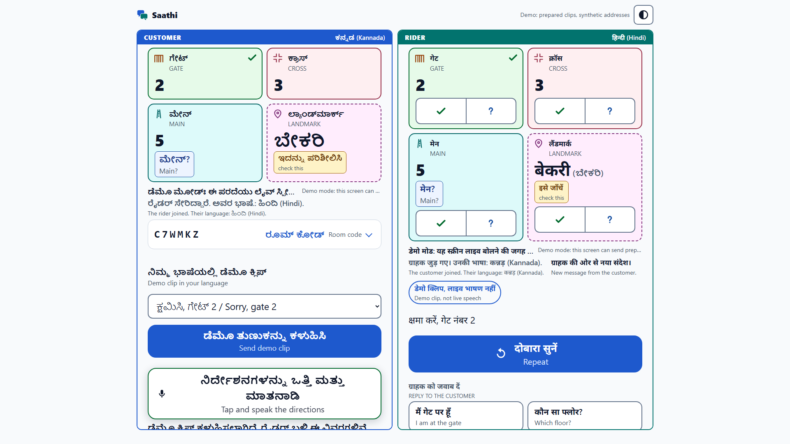
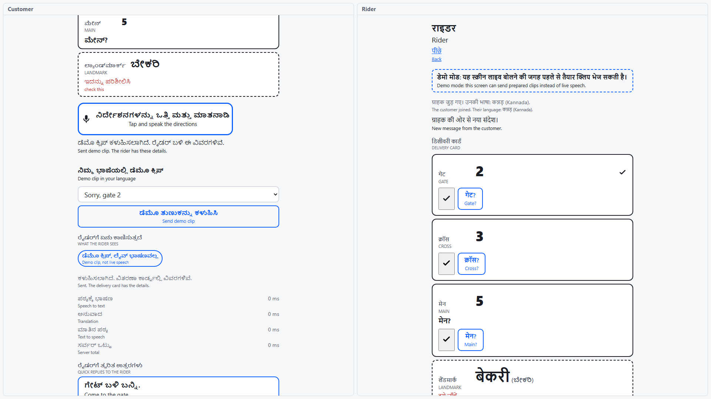
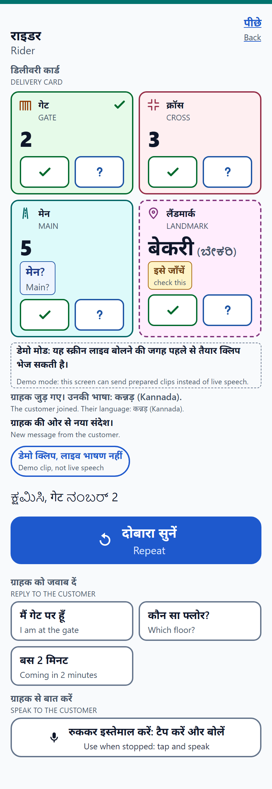
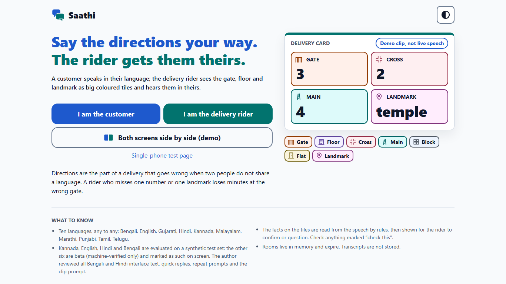
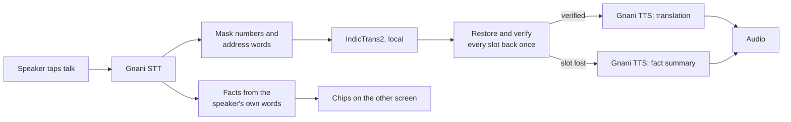

# Saathi

**A customer speaks delivery directions in their language; the rider, in another Indian language,
gets the gate, floor, cross, main and landmark as big chips plus translated audio.**

**Try it:** https://saathi.indiasouthcentral.cloudapp.azure.com. Open "Both screens side by side
(demo)", pick a customer language and a rider language, and send a demo clip. The guided demo
replays stored clips and spends no Gnani credits.

Demo video: (link added after recording)

Built on Gnani Prisma (speech to text) and Timbre (text to speech), with IndicTrans2 run locally for
translation. An entry to the Gnani.ai Great Indian AI Internship Challenge.

[](https://github.com/rahulpaul-07/saathi/actions/workflows/ci.yml)



**It handles code-mixed speech.** People give directions in one language with English address words
in it: Kannada with "2nd cross" and "gate number". Gnani's Kannada speech to text writes those words
in Kannada script (ಕ್ರಾಸ್, ಮೇನ್, ಗೇಟ್ ನಂಬರ್, ಆಪೋಸಿಟ್), as the probe transcripts in
[probe_codemix.json](eval/results/probe_codemix.json) show, and the Kannada street clip
`kn-wrong-translation` (one of five earlier clips, so not blind) was read as cross 2, main 3, gate 2
and its landmark. The demo set has one code-mixed clip per language (the `mixed` rows of the
[first pass](eval/results/demo_set_first_pass.md) and the
[re-score after fixes](eval/results/demo_set_after_fixes.md)): 3 of those 10 had exactly the
expected facts on the held-out first pass and 5 of 10 after the fixes, which is not held-out. The
Kannada code-mixed clip still misses its cross: the speech service wrote "class" for "cross". All of
this is synthetic speech; real phone audio of code-mixed directions was not tested.

Three numbers, each from a result file:

| Number | What it is | Data |
|---|---|---|
| 23 of 50 | Synthetic clips (5 types x 10 languages) with exactly the expected facts on the held-out first pass. 34 of 50 after fixes written while reading the same transcripts, so that figure is not held-out. | [first pass](eval/results/demo_set_first_pass.md), [after fixes](eval/results/demo_set_after_fixes.md) |
| 0.067 | Mean character error rate of the speech service on 100 real read-speech clips (FLEURS, 10 per language, 95% CI 0.043 to 0.097); 0.101 with street noise at 5 dB. | [speech_summary.md](eval/results/speech_summary.md) |
| 2.9 s | Median time for one spoken turn (speech to text, translation, text to speech); p95 4.0 s, slowest 16.2 s. Bengali to Kannada, n=20, one laptop on AC power with an RTX 3050 6 GB, clean synthetic audio, run 2026-11-01. Translation on 2 CPU cores was measured separately: about 3 s at the median and p95 5.5 to 5.8 s, two runs of n=20 on the same laptop. The hosted VM was not measured. | [latency.json](eval/results/latency.json), [cpu_latency.json](eval/results/cpu_latency.json) |

Why this matters:

- A fluent translation can still send a rider to the wrong gate: numbers and local words are the
  parts machine translation rewrites without anyone noticing.
- So the chips come from what the customer said, never from the translation, and the audio is only
  the backup.
- Any of 10 languages for either person, a short-lived room, no accounts and no stored transcripts.

Portfolio project. It runs on a LAN by default; an opt-in public mode with spending guards exists
(see [Public hosting](#public-hosting)). Every number below comes from a run described in
[`docs/EVAL.md`](docs/EVAL.md); anything not measured is said to be not measured.

## See it

| Before (earlier layout) | After (current; scripted sample text, not model output) |
|---|---|
|  |  |

The same moment on a 412 px wide phone, rider side, with the delivery card directly under the header (scripted sample text, not model output):



The landing page at 1366 x 768 in the light theme. The sample card is fixed example content drawn with the same code as the rider's screen, not model output:



These are in [`docs/media/design/current/`](docs/media/design/current/). The earlier five-step captures for both roles are in [`docs/media/design/before/`](docs/media/design/before/) and [`docs/media/design/after/`](docs/media/design/after/). The
people and addresses in them are synthetic; the clips are labelled demo clips.

## How it works



Gnani Prisma does speech to text, IndicTrans2 translates on the local GPU, Gnani Timbre does text to
speech. No hosted LLM. Layer by layer: [`docs/ARCHITECTURE.md`](docs/ARCHITECTURE.md); why each
choice was made: [`docs/DESIGN_FAQ.md`](docs/DESIGN_FAQ.md) and [`docs/DECISIONS.md`](docs/DECISIONS.md).

Safety layers, in the order a wrong fact would have to get past them:

1. **Chips from the source.** Facts are extracted from the transcript in the speaker's language. A
   wrong translation still sits next to correct chips.
2. **Fallback summary.** A translation that loses or duplicates a masked slot, or runs away, is not
   spoken; a short fact summary is spoken instead.
3. **Confirm or ask.** The rider can confirm a value or ask about one they doubt with one tap, and
   the customer sees which.
4. **Changed marker.** When a later turn changes a fact (gate 2 becomes gate 4), the card marks it
   instead of silently replacing it.

## Results

"Synthetic" means Gnani TTS speech. Sample sizes are small and the caveats are in the linked file.

| What | Result | n and conditions | Data |
|---|---|---|---|
| Fact recall, masking A/B (text) | 0.701 plain, 0.759 masked, 0.854 masked with summary fallback | 90 turns; 9 of 90 masked translations failed the check; fixed scorer | [masking_modes.json](eval/results/masking_modes.json) |
| Fact recall under street noise | 0.84 clean, 0.64 at 5 dB; drop 0.20, 95% CI 0.09 to 0.31 | n=20 test utterances, synthetic speech with one real street recording | [noise_summary_synth.md](eval/results/noise_summary_synth.md) |
| Speech error rate, real speech | pooled CER 0.067 clean, 0.101 at 5 dB | 100 FLEURS clips, 10 per language; en and te noisy at n=10 | [speech_summary.md](eval/results/speech_summary.md) |
| Fact extraction, ta te gu ml mr pa | 19 of 24 sentences fully right on the first run (recall 0.93, precision 1.00); 24 of 24 after the five missed spellings were added, which is not a held-out result | 4 synthetic sentences per language; the result file holds the 24 of 24 rerun, the first-run table is in EVAL.md | [facts_extra.json](eval/results/facts_extra.json), first run in [EVAL.md](docs/EVAL.md#fact-extraction-on-ta-te-gu-ml-mr-pa-held-out-synthetic-speech-run-2026-10-30) |
| Turn latency, bn to kn | p50 2.9 s, p95 4.0 s | n=20, AC power, one machine, run 2026-11-01, no retries or failures | [latency.json](eval/results/latency.json) |
| STT `format=transcribe` (digits) vs default verbatim | digits returned for kn, ta, te; extracted facts identical to the verbatim output | 3 synthetic clips, one per language; Saathi unchanged | [EVAL.md](docs/EVAL.md#stt-output-format-verbatim-vs-transcribe-3-real-calls-plus-1-failed-run-2026-11-03) |
| Live smoke through the HTTP API | passed, 6 Gnani calls | one kn to hi pair (an example), two prepared clips | [live_smoke.json](eval/results/live_smoke.json) |
| Journey tests | 10 language-pair journeys plus the split-screen journey, all passing | fake Gnani and translator, Playwright, two browser contexts | [`tests/e2e/journeys.spec.js`](tests/e2e/journeys.spec.js) |
| Translation-safety matrix, 10x10, back-translation score | 0.796 plain, 0.784 masked, 0.812 conditional masking | 90 pairs, 20 machine-generated sentences per pair, 5130 facts, local model, fixed scorer | [masking_conditional_matrix.json](eval/results/masking_conditional_matrix.json) |
| Same matrix, target-language score | 0.374 plain, 0.445 masked, 0.447 conditional | as above | [masking_conditional_matrix.json](eval/results/masking_conditional_matrix.json) |
| Guided-demo set, held-out first pass | 23 of 50 clips with exactly the expected facts | 50 synthetic clips, 5 types x 10 languages, expected facts written before the run; 5 clips were not built because Gnani returned a 504; 5 of the 50 are earlier clips that were not blind | [demo_set_first_pass.md](eval/results/demo_set_first_pass.md) |
| Same 50 clips after fixes, not held-out | 34 of 50 | the fixes were written while reading these transcripts, so this is a regression check and not accuracy; 2 clips are still unbuilt after a retry | [demo_set_after_fixes.md](eval/results/demo_set_after_fixes.md) |
| Guided-demo replay, all 90 ordered language pairs | 90 of 90 pairs passed; 306 clip replays, 0 failed; all 306 with stored rider audio, 0 text-only; median 2 ms, 95th percentile 3 ms, slowest 18 ms per replay; 24 of the 306 stored translations failed the placeholder check and gave the facts-only text (21 of them for Bengali and Malayalam riders) | the 34 clips whose stored transcripts give exactly the expected facts, sent through the room API in public mode with every translation, fact set and voice read from the stored bundle, and no speech service; 272 voices built once with real Gnani calls, 0 Gnani calls in this run; times taken on AC power, a correctness run and not a benchmark | [language_matrix.md](eval/results/language_matrix.md) |

Scorer note, 2026-11-01: the English fact extractor was fixed to read "Gate No. 2" and "4 floors", and every fact-recall number above uses the fixed one. Before the fix the same outputs scored 0.674 / 0.747 / 0.843 (A/B, kept in [masking_ab.json](eval/results/masking_ab.json)) and 0.748 plain / 0.679 masked (matrix back score, [translation_matrix.json](eval/results/translation_matrix.json)). The noise, speech and extraction rows are identical under both scorers. Default masking stays `current`; the comparison is in `docs/EVAL.md`.

Not measured: real phone audio, real delivery customers, a native-speaker review of any lexicon or
quick reply, more than one process, a long soak, and anything in production conditions. The gold-set
extraction scores are optimistic because the gold texts are written in forms the recognizer was
observed to produce.

## Product

How this would be run as a product: who it is for, what it should achieve, and how to test whether it helps. These documents are written by the author and no delivery rider has been interviewed yet, so the problem statement is an assumption until that is done.

- [One-page summary](docs/product/ONE_PAGER.md)
- [Product requirements (PRD)](docs/product/PRD.md): requirements graded by evidence, metrics, launch gates
- [Competitive analysis](docs/product/COMPETITIVE_ANALYSIS.md)
- [Pilot experiment design](docs/product/PILOT_EXPERIMENT.md)
- [Roadmap](docs/product/ROADMAP.md), [backlog](docs/product/BACKLOG.md), [UX audit](docs/product/UX_AUDIT.md), [market sizing](docs/product/MARKET_SIZING.md), [rider interview guide](docs/product/RIDER_INTERVIEWS.md)

## What works in all 10 languages

Bengali, English, Gujarati, Hindi, Kannada, Malayalam, Marathi, Punjabi, Tamil and Telugu work as
either role: speaking a turn, chips, translated audio, quick replies (3 phrases per role) and
the interface text. Language support is one table, [`languages.py`](src/saathi/languages.py).

| Tier | Languages | What backs it |
|---|---|---|
| Core | kn, en, hi, bn | evaluated on the synthetic gold set |
| Beta | gu, ml, mr, pa, ta, te | machine-verified only; labelled "beta" in the UI |

"Machine-verified" means each number word and trigger is a spelling the real Gnani STT wrote when it
heard Gnani TTS speech ([`docs/LEXICON_EVIDENCE.md`](docs/LEXICON_EVIDENCE.md)). No speaker
has checked the beta languages, and none has checked kn. "Reviewed by the author" applies only to bn and hi
and covers exactly: all bn and hi interface strings, quick replies, repeat prompts and the clip prompt.
Every other translation is machine output and is marked unreviewed in the UI. Odia, Assamese and Urdu are not offered: Gnani supports none of them for both
speech input and output.

## Security

Addresses are personal data. Rooms are in memory and expire (30 min idle, 2 h hard when run locally; 10 min idle, 1 h hard in public mode by default); transcripts are
never logged or stored; tests, evaluation and demos use synthetic addresses only; the API key never
reaches logs or settings output (tested). Per-IP and per-room rate limits, bounded uploads and
queues, strict input schemas, generic error messages and a strict content security policy. The full
model, including what it does not cover, is [`docs/THREAT_MODEL.md`](docs/THREAT_MODEL.md). It has
had no external review.

## Path to production

Not production-ready. [`docs/PATH_TO_PRODUCTION.md`](docs/PATH_TO_PRODUCTION.md) covers integration
with a delivery partner, scale, cost per conversation, telephony beside masked calling, India's DPDP
Act obligations and what is missing. There are no accounts and no history.

## Public hosting

Off unless `SAATHI_PUBLIC=1`; unset, the app behaves exactly as for local use. When on, it adds:

- **Client IP only from trusted proxies.** `X-Forwarded-For` is believed only when the connection
  comes from an address in `SAATHI_TRUSTED_PROXIES`, so a client cannot spoof its way past the
  per-IP limits (tested).
- **A daily Gnani call budget** (UTC day, saved to disk, so a restart does not reset it) and a
  **kill switch** (a file, checked on every call, no restart). Every HTTP attempt is counted,
  retries included; when spent, live turns return a clear 503 and nothing is sent to Gnani.
- **Caps** on rooms, room lifetime, room creations per IP per hour and upload size.
- **A guided demo** that replays 34 prepared clips (recorded once with real calls) through the real
  screens with zero Gnani calls. Every clip has a stored turn for each of the nine other rider languages:
  the translation, the facts and the spoken audio are read from the bundle, with no translation at
  serve time. A clip outside the bundle is refused, never sent live.
- A CPU container image, a QR code for the rider link, and translation models pinned to full
  commits because they run Hub-hosted code.

Deployment steps and exactly what was and was not tested: [`docs/DEPLOY.md`](docs/DEPLOY.md). On
CPU with 2 cores, translation alone took a median of about 3 s (p95 about 5.5 to 5.8 s) in two runs
on a laptop ([`eval/results/cpu_latency.json`](eval/results/cpu_latency.json)); a cloud host was not
measured.

## Honest limits

- Translation is machine output and no human has reviewed the renderings. A wrong but fluent
  translation is possible; the chips and the masking exist because of that.
- Masking helped on speech-style text in one test and lost in another (matrix row above, diagnosis
  in `docs/EVAL.md`). It is a modest improvement, not a guarantee.
- Synthetic speech is clean and one voice per language; it cannot reproduce phone microphones.
- Small samples are small: 4 sentences per language in the held-out set, 20 utterances in the noise
  test.
- **A wrong transcript gives a missing or garbled chip.** The extractor reports what the transcript
  says. In the held-out first pass, 12 of the 27 clips that failed had a wrong transcript ("mail" for
  "main", "class" for "cross", a garbled "flat twelve"), and 12 of the 16 that still fail after the
  fixes do.
- **The guided demo shows the clips that work.** Its picker lists the 34 of 50 clips whose facts
  matched in full after the fixes; the other 16 stay in the evaluation set. The held-out figure is
  23 of 50, not 34.
- **Marathi landmarks are limited to two cues.** A landmark is read only when its name is followed
  by "समोर" (in front of) or "मागे" (behind), including when the speech service glues the cue to the
  name ("स्कूलसमोर"). "Near" and "next to" are not read. In the demo set the Marathi street clip lost
  its landmark because the speech service garbled the word.
- **Number words above 20 are not read in Tamil, Telugu, Gujarati, Malayalam, Marathi and Punjabi.**
  Their number words were probed only up to 20, and in those probes the speech service wrote number
  words, not digits. A gate, floor or flat above 20 spoken in these languages is expected to give no
  chip unless the service writes digits; this was not tested.
- **Malayalam and Bengali riders get the facts-only text most often.** In the 10x10 guided-demo
  replay, the check that each masked number and address word comes back from the translator exactly
  once failed for 13 of 31 replays to Malayalam and 8 of 30 to Bengali; the other eight languages had
  3 failures between them (24 of 306 in all). Those riders get the facts spelled out from tables
  instead of the model's sentence, and the delivery card is unaffected. Each translation is made
  once when the bundle is built and the result is stored, so this count no longer varies between
  matrix runs; it varied between earlier runs that translated at serve time (30 and 36 in two runs
  that were not kept, 21 in a third), and the cause was not established.
- **The guided demo is replayed, not live.** It plays stored transcripts and audio, so it shows the
  screens and the fact pipeline but not how the speech service does on what a visitor says. Every
  rider language has a stored voice for every picker clip; a pair missing from the bundle would be
  translated on the host from the stored transcript and have no audio. Live microphone turns spend Gnani credit and are bounded by a daily budget (the
  code's default is 200 requests per UTC day, the live server is set to 150, and a live turn takes two); once it is spent, live
  turns are refused with a 503 and only the guided demo works until the next UTC day.
- The translation models are comfortable on a GPU (an RTX 3050 6 GB here) and slower on a CPU. The
  public site runs on a single 2-vCPU VM, so translation there runs on the CPU: on 2 cores in a
  container on the laptop it took about 3 s at the median (p95 5.5 to 5.8 s), so expect the hosted
  site to be slower than the GPU latency figures above. The VM itself was not measured, nor how many
  people it can serve at once. Rooms live in the memory of one process, at most 20 at a time by
  default in public mode, and a restart ends every open room.
- The Gnani STT endpoint returned intermittent 504 errors in the long runs; the scripts are
  resumable. Two of the 50 demo clips (`te-correction`, `pa-mixed`) never built because it returned
  504 again on retry.
- **The all-languages screen check used this machine's fonts.** Customer and rider screens in all 10
  languages were checked in a real browser at 412x915 and 1280x800: every label present and in the
  right script, no raw keys or "undefined", no missing-glyph boxes, no silently clipped text. The app
  ships no web fonts, so a device without Indic fonts will show boxes. The check cannot tell Hindi
  from Marathi (both Devanagari), and the Tamil prompt "Choose a clip" is cut with an ellipsis in
  the clip picker on a 412 px phone.
- iOS Safari is untested, and the microphone needs localhost or HTTPS.

## Try it locally

You need Python 3.12 (managed by `uv`), Node 24 for the UI checks, an NVIDIA GPU for speed, a
Hugging Face account that has accepted the terms for the three gated models
`ai4bharat/indictrans2-indic-indic-dist-320M`, `-en-indic-dist-200M` and `-indic-en-dist-200M`
(then `uv run hf auth login`), and a Gnani API key as `GNANI_API_KEY` in `.env` (copy `.env.example`).
Each live turn spends Gnani credit; the tests and the e2e suite use fakes and spend none.

```
uv sync
uv run --no-sync uvicorn saathi.app:create_app --factory --host 127.0.0.1 --port 8000
```

To use it from a phone on the same network you must bind `0.0.0.0`; see [`docs/LAN_CHECK.md`](docs/LAN_CHECK.md). The server has no login, so anyone on that network with a room code can join.

Open `http://localhost:8000/customer.html` and `/rider.html` in two tabs (or `/demo.html` with
`SAATHI_DEMO_INPUT=1` and prepared clips, see [`docs/DEMO_SCRIPT.md`](docs/DEMO_SCRIPT.md)).
Startup loads the models and runs warm-up translations (about 12 s per model).

| Platform | Notes |
|---|---|
| Windows | Install "Desktop development with C++" build tools first: IndicTransToolkit compiles a Cython extension. Commands above run in PowerShell. |
| macOS, Linux | The code is not Windows-specific, but only Windows was tested. You need a C compiler for the same extension. Torch comes from the CUDA index in `uv.lock`; on a machine without NVIDIA hardware, install a CPU torch and expect slow translation. |

Two phones on a LAN: [`docs/LAN_CHECK.md`](docs/LAN_CHECK.md).

**Slow connection.** torch is a single 2.7 GB download and `uv sync` cannot resume it. Download the
wheel with a resumable tool, check its hash, install it by hand, and from then on run commands with
`uv run --no-sync` and sync with `uv sync --inexact --no-install-package torch`:

```
curl.exe -L -C - -o torch-2.9.1+cu128-cp312-cp312-win_amd64.whl https://download-r2.pytorch.org/whl/cu128/torch-2.9.1%2Bcu128-cp312-cp312-win_amd64.whl
```

SHA256 must be `3a01f0b64c10a82d444d9fd06b3e8c567b1158b76b2764b8f51bfd8f535064b0`
(`Get-FileHash <file> -Algorithm SHA256`). Then `uv sync --inexact --no-install-package torch` and
`uv pip install <path-to>\torch-2.9.1+cu128-cp312-cp312-win_amd64.whl`. A plain `uv sync` tries to
download torch again, and `--no-install-package torch` without `--inexact` uninstalls it.

Checks:

```
uv run --no-sync pytest                      # fast tests, fakes only
uv run --no-sync pytest -m model             # the real IndicTrans2 models
uv run --no-sync ruff check . ; uv run --no-sync mypy src tests scripts
npm ci                                       # once; dev tooling only
npm run typecheck ; npm test ; npm run e2e
```

Evaluation scripts live in [`scripts/`](scripts/); each prints its plan with `--dry-run` before any
Gnani call and goes through a persisted call ledger with a hard cap. Recordings of people, if ever
added, stay in `eval/audio/` (gitignored) and are reported as consented human speech.

## Credits and licences

The code is MIT, see [`LICENSE`](LICENSE). Third-party components, data and their licences are in
[`THIRD_PARTY_NOTICES.md`](THIRD_PARTY_NOTICES.md); in short:

- **Gnani** Prisma (speech to text) and Timbre (text to speech): commercial APIs used under the
  author's own key; nothing of Gnani's is redistributed.
- **IndicTrans2** and **IndicTransToolkit** (AI4Bharat): run locally; the models are gated on
  Hugging Face and their terms apply. Weights are not in this repo.
- **FLEURS** (Google), CC BY 4.0: real speech for the CER evaluation, downloaded, not committed.
- **FLORES-200** devtest (Meta AI, NLLB team), CC BY-SA 4.0: the translation evaluation. Result
  files holding model outputs for FLORES inputs carry the same licence.
- **"College Street"** by Calcuttan, Freesound sound 181026, CC BY 4.0: the street-noise recording
  mixed into the noise evaluation.
