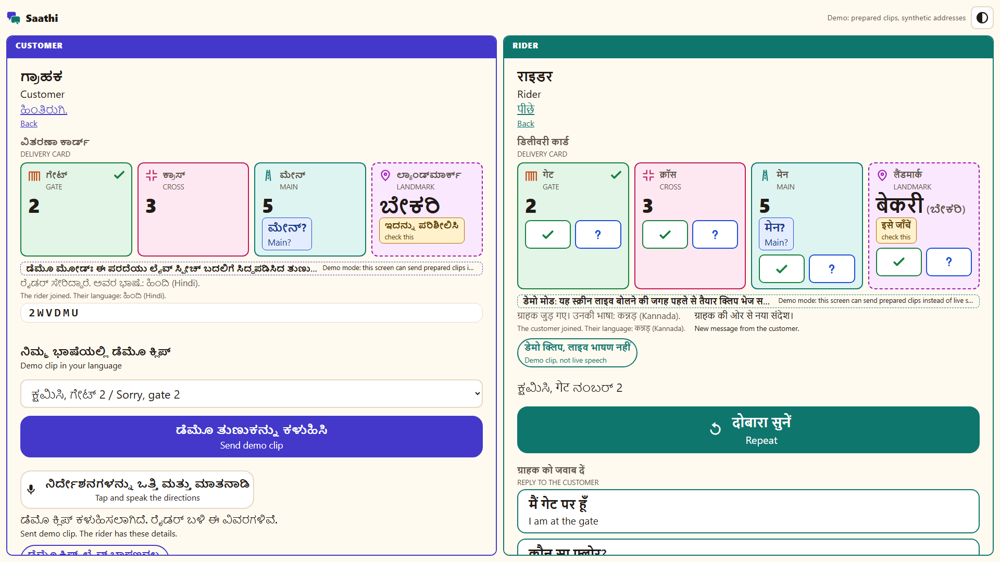
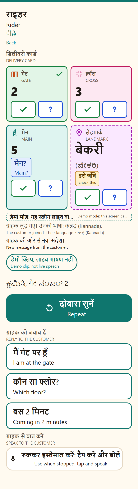
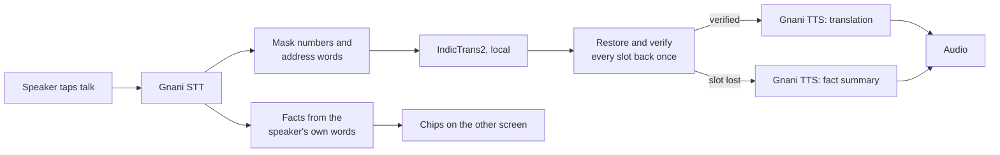

# Saathi

[](https://github.com/rahulpaul-07/saathi/actions/workflows/ci.yml)

Built for the Gnani.ai Great Indian AI Internship Challenge.

Demo video: (link added after recording)

**A customer speaks delivery directions in their language; the rider, in another Indian language,
gets the gate, floor, cross, main and landmark as big chips plus translated audio.**



Why this matters:

- A fluent translation can still send a rider to the wrong gate: numbers and local words are the
  parts machine translation rewrites without anyone noticing.
- So the chips come from what the customer said, never from the translation, and the audio is only
  the backup.
- Any of 10 languages for either person, a short-lived room, no accounts and no stored transcripts.

Portfolio project. It runs on a LAN by default; an opt-in public mode with spending guards exists
(see [Public hosting](#public-hosting)). Every number below comes from a run described in
[`docs/EVAL.md`](docs/EVAL.md); anything not measured is said to be not measured.

## See it

| Before (earlier layout) | After (current) |
|---|---|
|  |  |

The same moment on a 360 px phone, rider side, with the delivery card directly under the header:



All five steps for both roles are in [`docs/media/design/after/`](docs/media/design/after/). The
people and addresses in them are synthetic; the clips are labelled demo clips.

## How it works



Gnani Prisma does speech to text, IndicTrans2 translates on the local GPU, Gnani Timbre does text to
speech. No hosted LLM. Layer by layer: [`docs/ARCHITECTURE.md`](docs/ARCHITECTURE.md); why each
choice was made: [`docs/DESIGN_FAQ.md`](docs/DESIGN_FAQ.md) and [`docs/DECISIONS.md`](docs/DECISIONS.md).

Safety layers, in the order a wrong fact would have to get past them:

1. **Chips from the source.** Facts are extracted from the transcript in the speaker's language. A
   wrong translation still sits next to correct chips.
2. **Fallback summary.** A translation that loses or duplicates a masked slot, or runs away, is not
   spoken; a short fact summary is spoken instead.
3. **Confirm or ask.** The rider can confirm a value or ask about one they doubt with one tap, and
   the customer sees which.
4. **Changed marker.** When a later turn changes a fact (gate 2 becomes gate 4), the card marks it
   instead of silently replacing it.

## Results

"Synthetic" means Gnani TTS speech. Sample sizes are small and the caveats are in the linked file.

| What | Result | n and conditions | Data |
|---|---|---|---|
| Fact recall, masking A/B (text) | 0.701 plain, 0.759 masked, 0.854 masked with summary fallback | 90 turns; 9 of 90 masked translations failed the check; fixed scorer | [masking_modes.json](eval/results/masking_modes.json) |
| Fact recall under street noise | 0.84 clean, 0.64 at 5 dB; drop 0.20, 95% CI 0.09 to 0.31 | n=20 test utterances, synthetic speech with one real street recording | [noise_summary_synth.md](eval/results/noise_summary_synth.md) |
| Speech error rate, real speech | pooled CER 0.067 clean, 0.101 at 5 dB | 100 FLEURS clips, 10 per language; en and te noisy at n=10 | [speech_summary.md](eval/results/speech_summary.md) |
| Fact extraction, ta te gu ml mr pa | 19 of 24 sentences fully right on the first run (recall 0.93, precision 1.00); 24 of 24 after the five missed spellings were added, which is not a held-out result | 4 synthetic sentences per language; the result file holds the 24 of 24 rerun, the first-run table is in EVAL.md | [facts_extra.json](eval/results/facts_extra.json), first run in [EVAL.md](docs/EVAL.md#fact-extraction-on-ta-te-gu-ml-mr-pa-held-out-synthetic-speech-run-2026-10-30) |
| Turn latency, bn to kn | p50 2.9 s, p95 4.0 s | n=20, AC power, one machine, run 2026-11-01, no retries or failures | [latency.json](eval/results/latency.json) |
| Live smoke through the HTTP API | passed, 6 Gnani calls | one kn to hi pair (an example), two prepared clips | [live_smoke.json](eval/results/live_smoke.json) |
| Journey tests | 10 language-pair journeys plus the split-screen journey, all passing | fake Gnani and translator, Playwright, two browser contexts | [`tests/e2e/journeys.spec.js`](tests/e2e/journeys.spec.js) |
| Translation-safety matrix, 10x10, back-translation score | 0.796 plain, 0.784 masked, 0.812 conditional masking | 90 pairs, 20 machine-generated sentences per pair, 5130 facts, local model, fixed scorer | [masking_conditional_matrix.json](eval/results/masking_conditional_matrix.json) |
| Same matrix, target-language score | 0.374 plain, 0.445 masked, 0.447 conditional | as above | [masking_conditional_matrix.json](eval/results/masking_conditional_matrix.json) |

Scorer note, 2026-11-01: the English fact extractor was fixed to read "Gate No. 2" and "4 floors", and every fact-recall number above uses the fixed one. Before the fix the same outputs scored 0.674 / 0.747 / 0.843 (A/B, kept in [masking_ab.json](eval/results/masking_ab.json)) and 0.748 plain / 0.679 masked (matrix back score, [translation_matrix.json](eval/results/translation_matrix.json)). The noise, speech and extraction rows are identical under both scorers. Default masking stays `current`; the comparison is in `docs/EVAL.md`.

Not measured: real phone audio, real delivery customers, a native-speaker review of any lexicon or
quick reply, more than one process, a long soak, and anything in production conditions. The gold-set
extraction scores are optimistic because the gold texts are written in forms the recognizer was
observed to produce.

## What works in all 10 languages

Bengali, English, Gujarati, Hindi, Kannada, Malayalam, Marathi, Punjabi, Tamil and Telugu work as
either role: speaking a turn, chips, translated audio, quick replies (3 phrases per role) and
the interface text. Language support is one table, [`languages.py`](src/saathi/languages.py).

| Tier | Languages | What backs it |
|---|---|---|
| Core | kn, en, hi, bn | evaluated on the synthetic gold set |
| Beta | gu, ml, mr, pa, ta, te | machine-verified only; labelled "beta" in the UI |

"Machine-verified" means each number word and trigger is a spelling the real Gnani STT wrote when it
heard Gnani TTS speech ([`docs/LEXICON_EVIDENCE.md`](docs/LEXICON_EVIDENCE.md)). No speaker
has checked the beta languages, and none has checked kn. "Reviewed by the author" applies only to bn and hi
and covers exactly: all bn and hi interface strings, quick replies, repeat prompts and the clip prompt.
Every other translation is machine output and is marked unreviewed in the UI. Odia, Assamese and Urdu are not offered: Gnani supports none of them for both
speech input and output.

## Security

Addresses are personal data. Rooms are in memory and expire (30 min idle, 2 h hard); transcripts are
never logged or stored; tests, evaluation and demos use synthetic addresses only; the API key never
reaches logs or settings output (tested). Per-IP and per-room rate limits, bounded uploads and
queues, strict input schemas, generic error messages and a strict content security policy. The full
model, including what it does not cover, is [`docs/THREAT_MODEL.md`](docs/THREAT_MODEL.md). It has
had no external review.

## Path to production

Not production-ready. [`docs/PATH_TO_PRODUCTION.md`](docs/PATH_TO_PRODUCTION.md) covers integration
with a delivery partner, scale, cost per conversation, telephony beside masked calling, India's DPDP
Act obligations and what is missing. There are no accounts and no history.

## Public hosting

Off unless `SAATHI_PUBLIC=1`; unset, the app behaves exactly as for local use. When on, it adds:

- **Client IP only from trusted proxies.** `X-Forwarded-For` is believed only when the connection
  comes from an address in `SAATHI_TRUSTED_PROXIES`, so a client cannot spoof its way past the
  per-IP limits (tested).
- **A daily Gnani call budget** (UTC day, saved to disk, so a restart does not reset it) and a
  **kill switch** (a file, checked on every call, no restart). Every HTTP attempt is counted,
  retries included; when spent, live turns return a clear 503 and nothing is sent to Gnani.
- **Caps** on rooms, room lifetime, room creations per IP per hour and upload size.
- **A guided demo** that replays 5 stored turns (recorded once with real calls) through the real
  screens with zero Gnani calls. A clip outside the bundle is refused, never sent live.
- A CPU container image, a QR code for the rider link, and translation models pinned to full
  commits because they run Hub-hosted code.

Deployment steps and exactly what was and was not tested: [`docs/DEPLOY.md`](docs/DEPLOY.md). On
CPU with 2 cores, translation alone took a median of about 3 s (p95 about 5.5 to 5.8 s) in two runs
on a laptop ([`eval/results/cpu_latency.json`](eval/results/cpu_latency.json)); a cloud host was not
measured.

## Honest limits

- Translation is machine output and no human has reviewed the renderings. A wrong but fluent
  translation is possible; the chips and the masking exist because of that.
- Masking helped on speech-style text in one test and lost in another (matrix row above, diagnosis
  in `docs/EVAL.md`). It is a modest improvement, not a guarantee.
- Synthetic speech is clean and one voice per language; it cannot reproduce phone microphones.
- Small samples are small: 4 sentences per language in the held-out set, 20 utterances in the noise
  test.
- The translation models are comfortable on a GPU (an RTX 3050 6 GB here). On 2 CPU cores the
  translation step alone measured about 3 s at the median in a container on that laptop, so a
  CPU-only host feels slower than the GPU latency figures above; a cloud host was not measured.
- The Gnani STT endpoint returned intermittent 504 errors in the long runs; the scripts are
  resumable.
- iOS Safari is untested, and the microphone needs localhost or HTTPS.

## Try it locally

You need Python 3.12 (managed by `uv`), Node 24 for the UI checks, an NVIDIA GPU for speed, a
Hugging Face account that has accepted the terms for the three gated models
`ai4bharat/indictrans2-indic-indic-dist-320M`, `-en-indic-dist-200M` and `-indic-en-dist-200M`
(then `uv run hf auth login`), and a Gnani API key as `GNANI_API_KEY` in `.env` (copy `.env.example`).
Each live turn spends Gnani credit; the tests and the e2e suite use fakes and spend none.

```
uv sync
uv run --no-sync uvicorn saathi.app:create_app --factory --host 127.0.0.1 --port 8000
```

To use it from a phone on the same network you must bind `0.0.0.0`; see [`docs/LAN_CHECK.md`](docs/LAN_CHECK.md). The server has no login, so anyone on that network with a room code can join.

Open `http://localhost:8000/customer.html` and `/rider.html` in two tabs (or `/demo.html` with
`SAATHI_DEMO_INPUT=1` and prepared clips, see [`docs/DEMO_SCRIPT.md`](docs/DEMO_SCRIPT.md)).
Startup loads the models and runs warm-up translations (about 12 s per model).

| Platform | Notes |
|---|---|
| Windows | Install "Desktop development with C++" build tools first: IndicTransToolkit compiles a Cython extension. Commands above run in PowerShell. |
| macOS, Linux | The code is not Windows-specific, but only Windows was tested. You need a C compiler for the same extension. Torch comes from the CUDA index in `uv.lock`; on a machine without NVIDIA hardware, install a CPU torch and expect slow translation. |

Two phones on a LAN: [`docs/LAN_CHECK.md`](docs/LAN_CHECK.md).

**Slow connection.** torch is a single 2.7 GB download and `uv sync` cannot resume it. Download the
wheel with a resumable tool, check its hash, install it by hand, and from then on run commands with
`uv run --no-sync` and sync with `uv sync --inexact --no-install-package torch`:

```
curl.exe -L -C - -o torch-2.9.1+cu128-cp312-cp312-win_amd64.whl https://download-r2.pytorch.org/whl/cu128/torch-2.9.1%2Bcu128-cp312-cp312-win_amd64.whl
```

SHA256 must be `3a01f0b64c10a82d444d9fd06b3e8c567b1158b76b2764b8f51bfd8f535064b0`
(`Get-FileHash <file> -Algorithm SHA256`). Then `uv sync --inexact --no-install-package torch` and
`uv pip install <path-to>\torch-2.9.1+cu128-cp312-cp312-win_amd64.whl`. A plain `uv sync` tries to
download torch again, and `--no-install-package torch` without `--inexact` uninstalls it.

Checks:

```
uv run --no-sync pytest                      # fast tests, fakes only
uv run --no-sync pytest -m model             # the real IndicTrans2 models
uv run --no-sync ruff check . ; uv run --no-sync mypy src tests scripts
npm ci                                       # once; dev tooling only
npm run typecheck ; npm test ; npm run e2e
```

Evaluation scripts live in [`scripts/`](scripts/); each prints its plan with `--dry-run` before any
Gnani call and goes through a persisted call ledger with a hard cap. Recordings of people, if ever
added, stay in `eval/audio/` (gitignored) and are reported as consented human speech.

## Credits and licences

The code is MIT, see [`LICENSE`](LICENSE). Third-party components, data and their licences are in
[`THIRD_PARTY_NOTICES.md`](THIRD_PARTY_NOTICES.md); in short:

- **Gnani** Prisma (speech to text) and Timbre (text to speech): commercial APIs used under the
  author's own key; nothing of Gnani's is redistributed.
- **IndicTrans2** and **IndicTransToolkit** (AI4Bharat): run locally; the models are gated on
  Hugging Face and their terms apply. Weights are not in this repo.
- **FLEURS** (Google), CC BY 4.0: real speech for the CER evaluation, downloaded, not committed.
- **FLORES-200** devtest (Meta AI, NLLB team), CC BY-SA 4.0: the translation evaluation. Result
  files holding model outputs for FLORES inputs carry the same licence.
- **"College Street"** by Calcuttan, Freesound sound 181026, CC BY 4.0: the street-noise recording
  mixed into the noise evaluation.
