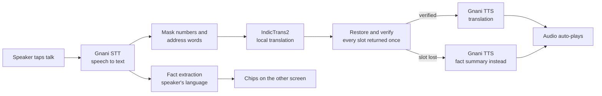

# Saathi

[](https://github.com/rahulpaul-07/saathi/actions/workflows/ci.yml)

A delivery rider and a customer often share no language. Saathi lets the customer speak the
directions in their own language and shows the rider, in theirs, the facts that matter as big chips
(gate, floor, cross/main, landmark) plus translated audio, in a short-lived room.

Portfolio project, work in progress, LAN only. Everything below marked "measured" comes from a run
described in `docs/EVAL.md`; anything not measured is said to be not measured.

## The problem

A rider on a bike cannot wait for a perfect sentence, cannot read a paragraph and cannot call back
three times. In Indian cities the customer and the rider often speak different languages, and the
one fact that gets the rider to the door ("second cross, gate 2, opposite the temple") is exactly
what machine translation is worst at: numbers and local words get rewritten, and nobody notices.

Saathi's answer is two independent channels:

- **Chips** are extracted from what the customer said (the speech transcript), in the speaker's own
  language, and never from the translation. A wrong translation still sits next to correct chips.
- **Audio** is the translation, spoken, as the backup. Numbers and address words are masked before
  translation and restored after, a modest improvement on speech-style input (not a guarantee);
  a translation that loses a slot is not spoken and a fact summary is spoken instead. The chips
  and that fallback are the safety layer.

Roles are independent of languages: the customer and the rider can each use any of the 10 languages,
in either direction, and either can answer by voice or with a quick reply. Any language pair shown in
demos or tests is only an example; the demo casting is not decided.

## How a turn flows



Gnani Prisma does speech to text, IndicTrans2 translates locally on the GPU, Gnani Timbre does text
to speech (loudness normalized for outdoor playback). No hosted LLM.

## Features

- Any-to-any across the 10 languages Gnani supports for both speech input and output: Bengali,
  English, Gujarati, Hindi, Kannada, Malayalam, Marathi, Punjabi, Tamil, Telugu. Language support is
  one table (`languages.py`), not per-language branches.
- Room with a 6-character code and a random 128-bit token per participant; rooms live in memory and
  expire (30 min idle, 2 h hard).
- Chips for gate, floor, cross, main, block, flat and landmark; values the recognizer renders
  ambiguously are shown as heard, not guessed.
- Quick replies for both roles in all 10 languages (3 phrases per role), sent in the recipient's
  language, with review status tracked per phrase.
- Repeat replays the audio locally with no network call.
- Failure behaviour that is tested: a translation that runs away or loses a slot is not spoken;
  Gnani errors give a safe generic message, not a stack trace.
- Evaluation tooling with a call ledger and a hard cap on Gnani calls; every script has a `--dry-run`.

## Languages and support tiers

| Tier | Languages | What backs it |
|---|---|---|
| Verified core | kn, en, hi, bn | native-word fact extraction rules, the synthetic gold set, quick replies in bn and hi partly author-reviewed |
| Reviewed | te | extraction lexicon machine-verified; quick replies to be checked by a speaker |
| Beta | gu, ml, mr, pa, ta | extraction lexicons machine-verified (a spelling the real STT wrote, not native-reviewed); labelled "beta" in the UI |

Odia, Assamese and Urdu are not offered: Gnani supports none of them for both speech input and
output, and a translation-only language cannot be spoken or heard here.

"Machine-verified" means each number word and trigger in the lexicon is a spelling the real Gnani
STT wrote when it heard Gnani TTS speech; no one who reads these languages has checked them. The
evidence is in `docs/LEXICON_EVIDENCE.md`. Marathi has no landmark chips (the STT glues the cue to
the name).

Review of quick replies is per phrase: only the rider's bn and hi phrases are author-reviewed; every
other translation is machine output, marked unreviewed in the UI until a speaker checks it.

## Evaluation summary

All numbers are from `docs/EVAL.md`, with their caveats there. "Synthetic" means Gnani TTS speech.

| What | Result | Data |
|---|---|---|
| Masking A/B, text only | fact recall 0.674 plain, 0.747 masked, 0.843 masked with summary fallback (90 turns; 9 of 90 masked translations failed the placeholder check). An earlier run showed 0.808 masked; it did not reproduce on current code or on 8e2d64d, cause unknown (2026-10-31) | synthetic gold text |
| Facts under street noise, test split n=20 | recall 0.84 clean, 0.64 at 5 dB; drop 0.20, 95% CI 0.09 to 0.31; no measurable cost at 20 dB | synthetic speech, one real street recording mixed in |
| STT on real speech, all 10 languages | pooled CER 0.067 clean, 0.101 at 5 dB (n=100 clips; en and te are noisy at n=10) | FLEURS, real read speech |
| Fact extraction, ta te gu ml mr pa | 19 of 24 sentences fully right on the first run (recall 0.93, precision 1.00); the 5 misses were spelling variants, since added | small held-out synthetic set, 4 per language |
| Turn latency bn to kn | p50 4.2 s, p95 11.3 s (n=19) during a stretch of Gnani 504s | synthetic clips, one machine |
| Translation, app pairs, full devtest | chrF++ 41 to 48 (greedy); bn to kn has 15 runaways in 1012 sentences, which the runaway guard catches | FLORES-200 |
| Load, fake Gnani, 50 rooms | 3000 turns, 0 errors, server time p50 39 ms | in-process, no model |
| Translation-safety matrix, 10x10 | back-translation score (translate, back-translate to English, English extractor): 0.75 plain, 0.68 masked over the 90 pairs (20 sentences per pair). Target-language score (extractor on the translated text, as in the A/B): masking helps, 0.37 plain to 0.51 masked (collected pairs only). Masking scores lower on the back-translation route mainly because the restore writes a bare digit, so "fourth floor" reads back as "4 floors", and the English extractor is strict ("Gate No. 2" is missed). Diagnosis covers 46 of 90 pairs until the collection is finished on AC power; no fix built | machine-generated source text, local model |

Not measured: real phone audio, real delivery customers, a native-speaker review of any lexicon or
quick reply, the start-of-clip effect, more than one process, a long soak, and anything in
production conditions. The fact-extraction scores on the gold set are optimistic because the gold
texts are written in the forms the recognizer was observed to produce.

## Security summary

Addresses are personal data. Rooms are in memory and expire; transcripts are never logged or stored;
tests, evaluation and demos use synthetic addresses only; the API key never reaches settings repr or
failure logs (tested). Per-IP and per-room rate limits, bounded uploads and queues, strict input
schemas, generic error messages, and a limiter that sweeps stale entries so memory cannot grow
without bound. The full model (room-code guessing, token theft, credit burn, upload abuse, SSE
exhaustion, key handling, demo-mode exposure, clickjacking) and what it does not cover is in
[`docs/THREAT_MODEL.md`](docs/THREAT_MODEL.md). It has had no external review.

## Path to production

Not production-ready, and `docs/PATH_TO_PRODUCTION.md` says why: integration with a delivery
partner, scale, cost per conversation, telephony beside masked calling, India's DPDP Act obligations
and a list of what is missing. This repo is LAN-only: no accounts, no history, no public deployment.

## Limits and honesty

- No accuracy claim beyond the table above. Small samples are small: the held-out language set has 4
  sentences per language, the noise test 20 utterances.
- Synthetic speech is clean and one voice per language; it cannot reproduce phone microphones.
- Translation is machine output and no human has reviewed the renderings. A wrong-but-fluent
  translation is possible; the chips and the masking exist because of that.
- The CPU fallback for the translation models exists but is untested. The GPU in use is an RTX 3050
  6 GB.
- The Gnani STT endpoint returned intermittent 504 errors during the overnight runs; scripts are
  resumable and stop on authorization errors.
- The tier labels describe the evidence behind each language, not a quality guarantee.
- The code has no licence file yet; until one is added, all rights are reserved by default.

## Requirements

- Windows, Python 3.12 (managed by `uv`), and an NVIDIA GPU (all three translation models together
  use about 1.4 GB of VRAM in fp16 on an RTX 3050 6 GB; the code falls back to CPU, which I have not
  tested)
- Microsoft C++ Build Tools ("Desktop development with C++"): IndicTransToolkit compiles a
  Cython extension on install
- A Hugging Face account that has accepted the terms for the three gated models
  `ai4bharat/indictrans2-indic-indic-dist-320M`, `ai4bharat/indictrans2-en-indic-dist-200M` and
  `ai4bharat/indictrans2-indic-en-dist-200M`, then `uv run hf auth login`
- ffmpeg (only to convert evaluation recordings)
- A Gnani API key in `.env` as `GNANI_API_KEY` (copy `.env.example`)

## Setup

```
uv sync
```

`uv.lock` takes torch from the official PyTorch `cu128` index, so this works on any machine with a
reasonable connection.

### Slow connection

torch is a single 2.7 GB download and `uv sync` cannot resume it. If it keeps stalling, download
the wheel with a resumable tool, check its hash, and install it by hand:

```
curl.exe -L -C - -o torch-2.9.1+cu128-cp312-cp312-win_amd64.whl https://download-r2.pytorch.org/whl/cu128/torch-2.9.1%2Bcu128-cp312-cp312-win_amd64.whl
```

The SHA256 must be `3a01f0b64c10a82d444d9fd06b3e8c567b1158b76b2764b8f51bfd8f535064b0`
(`Get-FileHash <file> -Algorithm SHA256`). Then:

```
uv sync --inexact --no-install-package torch
uv pip install <path-to>\torch-2.9.1+cu128-cp312-cp312-win_amd64.whl
```

After that, use the flags below, because uv sees the hand-installed torch as a different source
from the locked one:

- `uv run --no-sync <command>` (or set `UV_NO_SYNC=1`) to run without syncing.
- `uv sync --inexact --no-install-package torch` for any later sync. A plain `uv sync` or
  `uv run` tries to download torch again, and `--no-install-package torch` without `--inexact`
  uninstalls it.

Once, on a fast connection, run a plain `uv sync`. It fills the uv cache with the locked torch
wheel, and from then on the flags are not needed.

## Run

```
uv run --no-sync uvicorn saathi.app:create_app --factory --host 0.0.0.0 --port 8000
```

Startup loads the models and runs warm-up translations (about 12 s per model). Pages:

- `/customer.html` creates a room, shows what the rider says and sends quick replies.
- `/rider.html` joins with the code, shows chips, plays audio and sends quick replies; it can also
  record a turn.
- Neither page preselects a language.
- `/solo.html` is the original single-phone page (one device, both directions).

The microphone only works on localhost or HTTPS. On a laptop, use `http://localhost:8000`. For two
phones on a LAN, follow `docs/LAN_CHECK.md` (Android Chrome flag, hotspot, firewall rule and
cleanup). iOS Safari has no such flag; an iPhone can only be the rider, and that is untested.

Each turn spends Gnani credit. Real evaluation calls go through a persisted ledger with a hard cap
(`GNANI_CALL_CAP`), and every evaluation script has a `--dry-run` that shows the planned calls first.

## Tests and checks

```
uv run --no-sync pytest              # fast tests, no GPU or network (fakes)
uv run --no-sync pytest -m model     # real IndicTrans2 models on the GPU (needs the cached weights)
uv run --no-sync ruff check . ; uv run --no-sync mypy src tests scripts
npm ci                               # once; dev tooling only
npm run typecheck                    # tsc --noEmit, strict
npm test                             # node --test for the UI logic
npm run e2e                          # Playwright, two browser contexts, fake Gnani and translator
```

Text-only fact extraction scores on the synthetic gold set: `uv run --no-sync python scripts/score_facts.py`.

## Evaluation scripts

Each prints its plan with `--dry-run` before any call is made.

- `scripts/make_gold_tts.py`: the 30 gold sentences as Gnani TTS audio (labelled synthetic).
- `scripts/eval_noise.py run|report`: facts under street and pink noise at 20, 10 and 5 dB.
- `scripts/eval_speech.py run|report`: CER on FLEURS, 10 clips for each of the 10 languages.
- `scripts/eval_facts_extra.py run|report`: fact extraction for ta, te, gu, ml, mr and pa.
- `scripts/latency_study.py`: per-stage turn latency (AC power only).
- `scripts/load_rooms.py`: load test with a fake Gnani client, no credits.
- `scripts/eval_translation_matrix.py`: the offline X to Y safety matrix, local model only.
- Demo: `SAATHI_DEMO_INPUT=1` enables prepared clips (`scripts/make_demo_clips.py`) and the
  split-screen page `/demo.html`. No people appear in the demo; see `docs/DEMO_SCRIPT.md`.
- `docs/DESIGN.md` (architecture and plan) and `docs/DECISIONS.md` (why things are the way they are).

Nobody is recorded for this project. If someone's recording is ever added it stays in `eval/audio/`
(gitignored) and is reported as consented human speech.

## Credits and licences

- **Gnani** Prisma (speech to text) and Timbre (text to speech): commercial APIs used under the
  author's own key; no Gnani data or models are redistributed here.
- **IndicTrans2** and **IndicTransToolkit** (AI4Bharat): translation models run locally; the
  models are gated on Hugging Face and their terms apply. Weights are not in this repo.
- **FLEURS** (Google), CC BY 4.0, https://huggingface.co/datasets/google/fleurs: real speech for
  the CER evaluation. Clips are downloaded, not committed.
- **FLORES-200** devtest (Meta AI, NLLB team), CC BY-SA 4.0: the translation evaluation.
  Result files that contain model outputs for FLORES inputs carry the same licence.
- **"College Street"** by Calcuttan, Freesound sound 181026, CC BY 4.0,
  https://freesound.org/people/Calcuttan/sounds/181026/: the street-noise recording mixed into
  the noise evaluation.
- Details and exact attributions: `docs/EVAL.md`.
