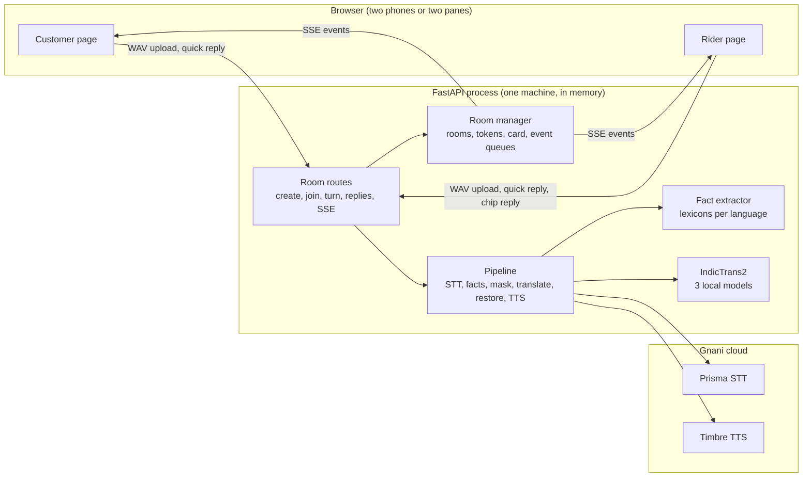
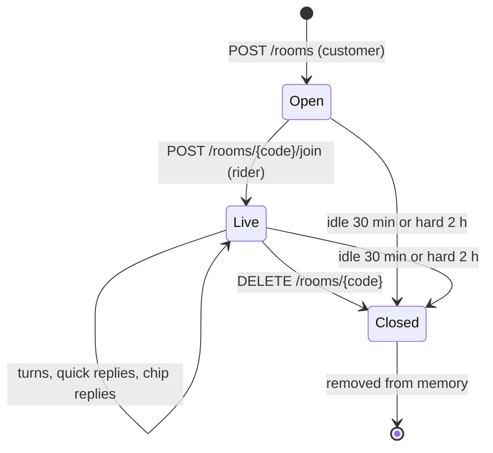

# Architecture

How Saathi is put together, for someone reading the code for the first time. `DESIGN.md` has the
plan and `DECISIONS.md` the reasons; this file is the map.

## System overview

Language support is one table (`languages.py`). The interface text, chip labels, quick replies and
error messages are also tables with a review status per entry (`chrome.py`, `labels.py`,
`quickreplies.py`, `unavailable.py`, `repeatprompts.py`). No code branches on a language.

## One turn, end to end

1. The speaker records in the browser; the page uploads a WAV to `POST /rooms/{code}/turn` with the
   speaker's bearer token. The route checks the token, the room, the size and the WAV header
   (`audio.wav_duration_s`), and rate limits per IP.
2. `pipeline.run_turn` sends the audio to Gnani STT. A 4xx from Gnani becomes `bad_recording`, a
   5xx or timeout is retried once, an empty transcript is `no_speech`.
3. `facts.extract_facts` reads the transcript in the speaker's language and returns gate, floor,
   cross, main, block, flat and landmark facts with their character spans. This does not depend on
   the translation.
4. `masking.mask` replaces each clear number value and each address loanword with a numbered
   placeholder (`#L51`, ...). IndicTrans2 translates the masked text locally. `masking.restore`
   writes the digits and the target-language loanwords back and checks that every placeholder came
   back exactly once.
5. If a placeholder was lost the translation is not spoken; `summary.fact_summary` builds a short
   sentence from the facts and the label tables instead. A runaway or repeating translation is
   refused with 422.
6. Landmark names are translated alone (`landmarks.localize_landmarks`) and shown only if they pass
   a plausibility rule; the listener sees "translation (original)".
7. Gnani TTS speaks the translation (or the summary); `loudness` normalises it.
8. The route publishes a `turn` event to the listener (translation, chips in the listener's
   language, `verified`, audio path), updates the room's card (customer turns only) and publishes a
   `card` event to both sides. The speaker gets the HTTP response, including per-stage timings.
9. The listener's page fetches the audio and plays it; Repeat replays it locally.

## Room lifecycle and events

A room holds two participants (random 128-bit tokens), the card, up to five audio blobs (60 s) and a
bounded event queue per participant. Rooms are capped at 50 and live only in memory.

| Event | Sent to | When |
|---|---|---|
| `state` | the subscriber | first event on every stream: language, peer, card, last turn and reply |
| `peer_joined` | customer | the rider joined |
| `turn` | the listener | a turn finished: translation, chips, `verified`, audio path |
| `card` | both | the card changed: entries in each viewer's labels, with changed, confirmed, asked |
| `quick_reply` | the recipient | a quick reply was sent, with its audio |
| `closed` | both | the room ended or expired |

Events are not replayed while a role has no open stream; the `state` snapshot (including the last
turn and reply for that recipient) is how a reload or reconnect catches up. Tokens are bearer
headers, so the browser reads SSE with `fetch`, not `EventSource`.

## Where each safety layer sits

| Layer | Where | What it protects against |
|---|---|---|
| Chips from the source transcript | `facts/`, step 3 | a wrong translation: the chips never pass through the translator |
| Placeholder masking and verify | `masking.py`, step 4 | numbers and address words rewritten by the model |
| Fact-summary fallback | `pipeline.py`, `summary.py`, step 5 | speaking a sentence with a lost or invented slot |
| Runaway and repetition guards | `translate.py`, `guard.py` | looping output reaching the rider as paid nonsense |
| Machine-translation labelling | `labels.py`, UI notes | unreviewed labels or phrases shown as if reviewed |
| Changed marker | `card.py` | a corrected value silently replacing the old one |
| Confirm and ask | `chip-reply` route, `card.py` | the rider acting on a value they doubt |
| Input and abuse limits | `room_routes.py`, `ratelimit.py`, `audio.py` | credit burn, oversized uploads, code guessing |
| Headers and CSP | `security_headers.py` | script injection, clickjacking |

## Local versus Gnani

| Stage | Where | Notes |
|---|---|---|
| Speech to text | Gnani Prisma (cloud) | the only place the speaker's audio leaves the machine |
| Fact extraction | local | pure Python, lexicons per language |
| Masking, restore, verify | local | pure Python |
| Translation | local IndicTrans2 (GPU, CPU fallback untested) | three distilled models, about 1.4 GB VRAM in fp16 |
| Landmark translation | local | same models |
| Text to speech | Gnani Timbre (cloud) | receives the translated text or the fact summary |
| Rooms, tokens, card, events | local, in memory | nothing is stored; transcripts are never logged |
| Evaluation ledger | local file under `eval/state/` | counts Gnani calls against a hard cap |

Everything that decides what the rider sees as a chip runs locally. The cloud sees speech and the
translated text, which is why addresses in tests, evaluations and demos are synthetic.
