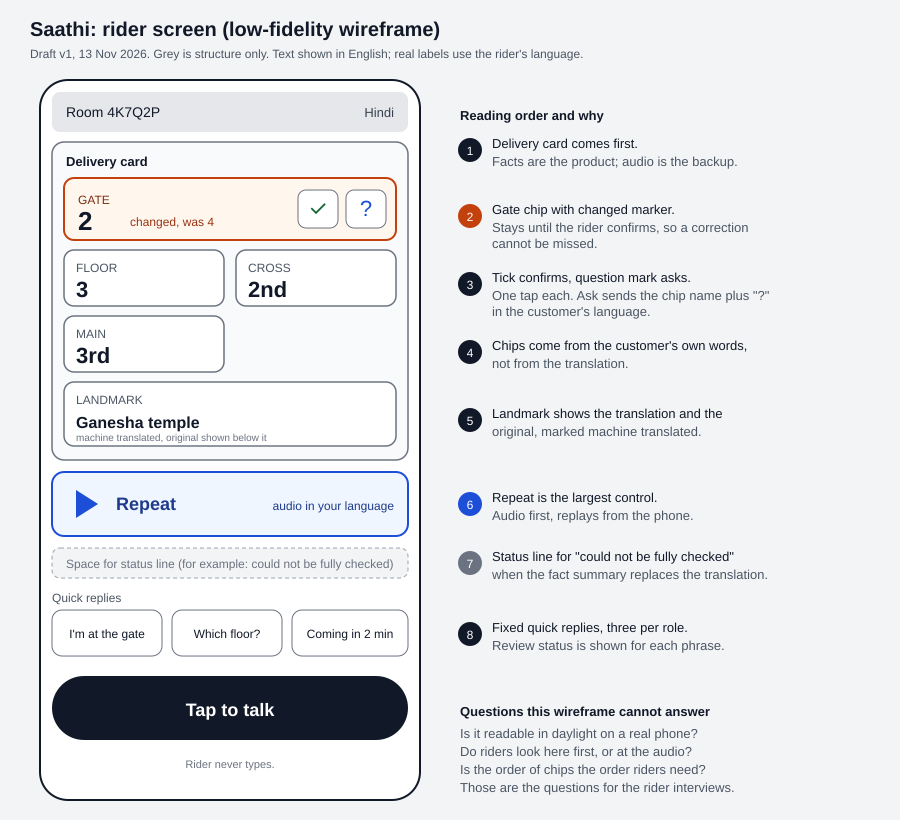

# Saathi: product and UX audit

Date: 13 Nov 2026. Based on repo commit 9929006 (all docs, the five HTML pages, `app.css`, the room and quick-reply modules, `eval/results/`) and the live site (landing, demo and customer setup pages). The in-room findings come from the repo's own screenshots in `docs/media/design/current/`, not from a live session, and nothing here was tested on a physical phone or with a rider.

Each finding says what was observed, why it matters, and what to do. Severity: High blocks the core job, Medium slows it, Low is polish.

## What already works

- The landing page states the job in one sentence and shows a sample card drawn with the real tile code. The demo button gives a one-device visitor a way in.
- The delivery card is the first thing in the room on both screens, and tile colour is never the only cue (dashed border for landmark, text badges for "check this" and "changed").
- The honesty is unusual and worth keeping: "Demo clip, not live speech" badges, beta labels, and a notice when interface text is unreviewed machine translation.
- The customer's microphone is pinned in the thumb zone.

## Findings

| # | Severity | Observed | Why it matters | Proposed change |
|---|---|---|---|---|
| 1 | High | On the 412 x 915 rider screenshot, four tiles with confirm and ask bars fill most of the first screen. Repeat lands near the bottom edge, and the quick replies and microphone are below the fold. In `app.css` only the customer's talk button is sticky. | The rider's next action after reading is to reply. The design goal says one tap; scrolling first is a second action, on a bike at a stop. | Pin Repeat and the three quick replies in a bottom bar on the rider screen (design proposal item 8, done for the customer only). Artboard "Rider: directions received". |
| 2 | Medium | The rider setup screen leads with an empty room-code text field. `rider.js` does pre-fill it from `?code=` when the rider opens the customer's link or QR, so typing is only needed on the manual path. | Goal 4 in `DESIGN.md` says the rider never types. The screen still presents typing as the default. | When the code arrives from the link, show it as already filled and lead with language and Join; keep manual entry as the fallback. Artboard "Rider: join from link". |
| 3 | Medium | Every tile carries its own confirm and ask bar, so a four-fact card has eight controls. | The value should be the loudest thing; eight buttons compete with it and cost about 50 px of height per tile. | Test with riders whether a single "all clear" plus tap-a-tile-to-ask does the job. Keep per-tile confirm only on a changed tile. This is a hypothesis, not a recommendation, until someone watches a rider use it. |
| 4 | Medium | Language is a 10-item dropdown that starts at "Choose a language", and Create room stays disabled until one is picked. | A dropdown is a small target and needs reading a list. | Large language buttons for the common choices, the rest behind "more". Pre-selecting from the browser language is worth considering. |
| 5 | Medium | Bilingual lines (own language plus English) appear on every label, status and button. | Useful for a demo audience; for a rider it doubles the text to scan. | Keep English on tile labels, where "GATE" matches signage. Drop it from status lines outside demo mode. |
| 6 | Medium | Three status lines sit between the card and the audio (demo banner, peer joined, new message). | They push Repeat down and none needs action. | One status line; move "customer joined" to a brief notice. |
| 7 | Medium | The "Main?" asked badge and the "check this" badge look alike and sit in the same place. | One means the rider asked, the other means the system is unsure. Mixing them up defeats both. | Different position and shape: asked state on the tile header, uncertainty next to the value. |
| 8 | Low | Quick replies are three per role. The rider has no "I can't find it" and the customer has no "wait, I'll repeat". | The fixed set is the rider's safe channel. | Decide additions from interviews, not guesses; each new phrase needs review in 10 languages. |
| 9 | Low | The Tamil prompt is cut with an ellipsis in the clip picker at 412 px (README, honest limits). | Demo only. | Allow the label to wrap. |
| 10 | Product gap | There is no content-free usage count anywhere. | The pilot metrics in the PRD (confirm rate, ask rate, please-repeat rate, fallback rate) cannot be collected. | Counters only, no transcript or address, behind a flag. |

## What to do first

1. Finding 1, because it is cheap and already designed.
2. Finding 2, a small layout change since the pre-fill already exists.
3. Finding 10, before any pilot.
4. Findings 3 to 7 only after watching riders use the current screen. They are judgment calls and a rider may disagree.

## Design file

The proposed rider screen is sketched in `img/rider_screen_wireframe.png` (source: `img/rider_screen_wireframe.svg`). It reuses the app's colour tokens. Labels in it that are not in the app today, such as "Rider is asking" and "Room code, filled from the link", would need translation and review before use. The other proposed screens are described in the findings above and have not been drawn here.
